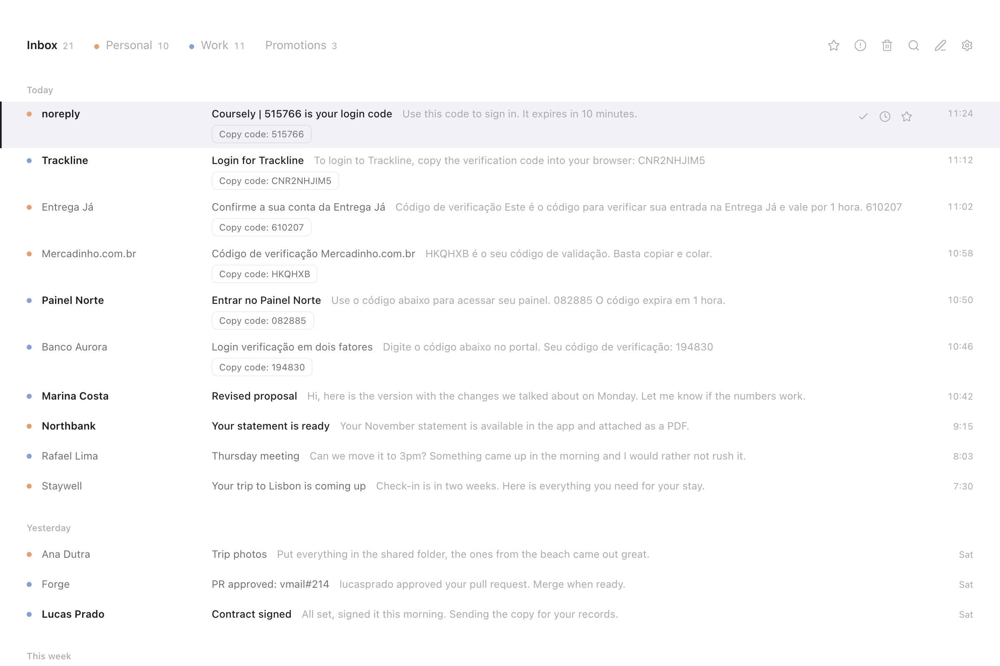
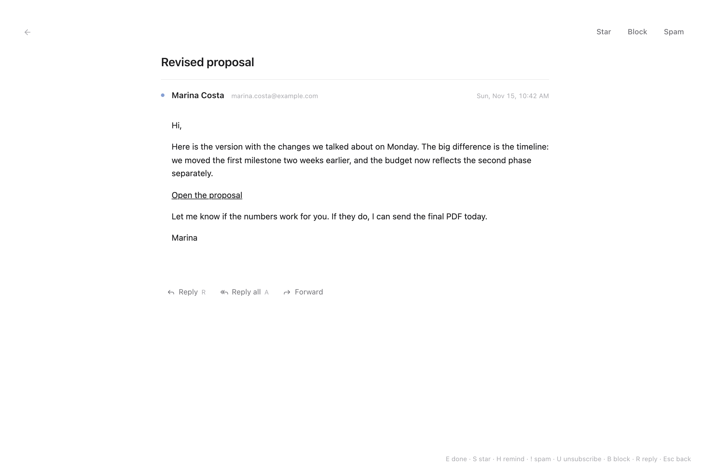

# voa

https://github.com/user-attachments/assets/34ca3106-45c8-429a-a106-e5f0ebbf6f92

One inbox for all your mail. Three ways out of a message: **done**, **star**, **remind me**. When the inbox is empty, a photo.

voa is a small desktop mail client for people who read mail for a living and want it to end. Every account (Gmail, a personal Outlook or Hotmail account, or any IMAP/SMTP server) lands in the same list, with a colored dot to tell them apart. There is no sidebar, no folders to tend and no settings maze. Your mail and tokens stay in a local database on your machine; there is no voa server. Mail is shown in an isolated frame: no scripts run, and links open in your browser. If a send might not have gone through, voa tells you to check Sent and never sends it again by itself.

## Download

[Download for Mac](https://github.com/plainroom/voa/releases/latest). Apple silicon only. Best on macOS 26, where summaries, labels, translation and Speak run on your Mac. It also opens on macOS 12 to 15.

Not notarized yet. The first time, right-click voa and choose Open.

Apple Intelligence stays on your Mac. Claude is optional: ⌘J uses your own Claude Code, and ⌘⇧J speaks a request.



| Reading | Inbox zero |
| --- | --- |
|  |  |

<sub>Screenshots from the built-in demo (`npm run dev`, then `?demo=1`): the names and mail are made up.</sub>

## What it does

- **One list** over every account. Tabs filter to one account (`1` to `9`), `0` shows all.
- **Done** archives. **Star** keeps it close. **Remind me** takes it out of the inbox and brings it back when you say: tonight, tomorrow morning, the weekend, next week, or a time you type ("tomorrow 9am", "sexta às 14h").
- **Undo** (`⌘Z`) for any of them.
- **Reading screen** with reply, reply all and forward in line; after done it moves to the next conversation.
- **Compose** with From, To, Subject and a body with bold, italic, links and lists. `Esc` discards, with an Undo that brings the draft back.
- **Search** across every account at once (`/` or `⌘F`). What is already on your machine shows as you type; the accounts are asked in the background and their hits join the list.
- **Block** a sender to take their mail out of the inbox; Settings lists who is blocked and can unblock them.
- **Spam and Trash** of every account in one list each (`g` then `p`, `g` then `t`). `e` in Trash moves a message back to the inbox. Spam never loads remote images by itself.
- **Promotions** that Gmail files under its Promotions tab stay out of the inbox and the Dock count, and sit on a Promotions pile. A newsletter Gmail files there will not show in the inbox: move it out of Promotions at Gmail to keep seeing it.
- **Inbox zero** shows a landscape photo, a new one each day.

## Install from source

You need [Node.js](https://nodejs.org/) 24 or newer, [Rust](https://www.rust-lang.org/tools/install) and the [Tauri v2 prerequisites](https://v2.tauri.app/start/prerequisites/) for your system.

```bash
git clone https://github.com/plainroom/voa.git
cd voa
npm install
npm run tauri build      # installer in src-tauri/target/release/bundle/
npm run tauri dev        # or run it in development
```

## Add your accounts

- **Gmail:** voa signs in with a Google OAuth client that you create once, in your own Google Cloud project. It takes about ten minutes: [docs/google-client.md](docs/google-client.md).
- **Outlook or Hotmail (personal accounts):** voa signs in through Microsoft with a client ID from an app you register once, in about five minutes: [docs/microsoft-client.md](docs/microsoft-client.md). Paste it under Microsoft in Settings, then Add account, Outlook.
- **Any other provider (or Gmail with an app password):** Settings, Add account, IMAP / SMTP. Well-known providers are filled in for you.

Open Settings with `,` or the gear at the top right.

## Keyboard

Keys are single letters and are ignored while you type in a field.

| Where | Key | Does |
| --- | --- | --- |
| Inbox | `j` `k` or `↓` `↑` | Move the selection |
| | `Enter` or `o` | Open |
| | `e` | Done |
| | `s` | Star or unstar |
| | `h` | Remind me |
| | `⌘Z` | Undo the last action |
| | `1` to `9`, `0` | Show one account, show all |
| | `g` then `i`, `s`, `h`, `p`, `t` | Go to Inbox, Starred, Snoozed, Spam, Trash |
| Trash | `e` | Move back to the inbox |
| | `c` | Compose |
| | `/` or `⌘F` (`Ctrl+F`) | Search |
| | `,` | Settings |
| Reading | `Esc` | Back to the list |
| | `e` `s` `h` `⌘Z` | Done, star, remind me, undo |
| | `r` `a` | Reply, reply all |
| | `⌘↵` (`Ctrl+Enter`) | Send the reply |
| Compose | `⌘↵` (`Ctrl+Enter`) | Send |
| | `Esc` | Discard (with Undo) |
| Search | `↓` `↑` `Enter` `Esc` | Move, open, back |

## Development

[docs/development.md](docs/development.md) has the commands. `npm run dev` with `?demo=1` shows an in-memory inbox in a browser (`?demo=zero` for inbox zero).

## Credits

- voa is a fork of [Velo](https://github.com/avihaymenahem/velo) by Avihay Menahem and contributors: the Tauri shell, the Gmail and IMAP sync engine and the local database are theirs.
- The inbox-zero photos are by photographers on [Unsplash](https://unsplash.com) and used under the [Unsplash License](https://unsplash.com/license); the credit shows under each photo in the app.

## License

[Apache-2.0](LICENSE). See [NOTICE](NOTICE).
